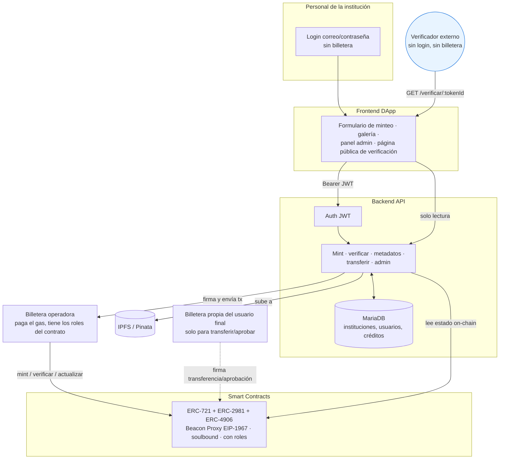

# Asset Tokenization Platform

[🇬🇧 English](README.md) | 🇪🇸 Español

> Infraestructura blockchain para la verificación instantánea e inalterable de certificados y documentos oficiales — diplomas, permisos, registros gubernamentales — construida para instituciones como universidades, notarías y entidades estatales, y que se extiende a bienes raíces, vehículos y otros activos del mundo real. Metadatos mutables, verificación on-chain, registros no transferibles donde se requiere, y una experiencia de onboarding que no exige conocimiento de blockchain ni a las instituciones ni a los usuarios finales.

Esta es la ingeniería detrás de **[Fidukio](https://fidukio.com)**, una plataforma SaaS colombiana de certificación digital de documentos, credenciales y activos — actualmente en proceso de fondeo semilla con el SENA (Fondo Emprender) rumbo a su formalización jurídica y al lanzamiento en Base mainnet. Este repo es solo documentación: es el mapa de un sistema funcional de tres repositorios — léelo primero, luego ve al código.

| | |
|---|---|
| ⚙️ [**Smart Contracts**](https://github.com/sergiom310/asset-tokenization-smart-contracts) | Solidity, OpenZeppelin, Beacon Proxy (EIP-1967), ERC-721/2981/4906 |
| 🔌 [**Backend API**](https://github.com/sergiom310/asset-tokenization-api) | Node.js, Express 5, instituciones multi-tenant, ethers.js |
| 💻 [**Frontend DApp**](https://github.com/sergiom310/asset-tokenization-dapp) | React 19, Ethers.js v6, UX con y sin billetera |

---

## El problema

Las instituciones que emiten o gestionan registros de activos del mundo real —registros de tierras, secretarías de tránsito, universidades, notarías, oficinas de propiedad intelectual, bancos— dependen de bases de datos centralizadas y rastros en papel lentos de verificar, fáciles de falsificar y costosos de reconciliar entre partes. Blockchain resuelve el problema de confianza, pero solo si la tecnología se mantiene invisible para quienes realmente tienen que usarla: el personal administrativo de una institución, y el tercero que verifica un registro meses o años después.

Esta plataforma está construida alrededor de esa restricción: **las instituciones operan mediante una aplicación web normal con login de correo/contraseña, los usuarios finales nunca necesitan una billetera para recibir un registro, y cualquiera puede verificar uno desde un enlace público sin ninguna cuenta.**

Hoy corre como una plataforma multi-tenant compartida, y el mismo código se despliega como una instancia dedicada de marca blanca para una institución o entidad gubernamental que quiera la suya propia — ver [Modelo de despliegue](#modelo-de-despliegue).

## Casos de uso

| Tipo de activo | Ejemplo real | ¿Transferible? |
|---|---|---|
| Certificado | Diploma, licencia profesional, credencial de formación | **No — soulbound** |
| Documento | Documento de identidad emitido por el estado, permiso oficial | **No — soulbound** |
| Bien raíz | Título de propiedad / escritura | Sí |
| Vehículo | Matrícula vehicular, registro de revisión técnica | Sí |
| Propiedad intelectual | Patente, marca, registro de derechos de autor | **No — soulbound** |
| Obra de arte / artículo de lujo | Registro de procedencia y autenticidad | Sí |

---

## Arquitectura

**Por qué el contrato es la capa que exige menos confianza:** cada minteo, verificación y restricción soulbound que ya está on-chain sigue siendo verificable de forma independiente contra el contrato mismo, incluso si el backend se redespliega, se reescribe o está temporalmente caído. El backend y el frontend existen para hacer esa confianza *utilizable*, no para sostenerla ellos mismos.

---

## Enfoque de ingeniería: construir, y luego auditarse a sí mismo

El `SECURITY.md` de cada repo documenta su modelo de control de acceso — y, con honestidad, qué se encontró mal durante la revisión y se corrigió, no solo lo que se ve bien:

- **Smart contracts**: se encontró y corrigió un problema de reentrancy en tiempo de minteo donde un contrato malicioso, mintado como receptor de un token soulbound (un certificado, un documento legal), podría haberlo transferido durante el callback de minteo, antes de que la bandera soulbound surtiera efecto — una violación de checks-effects-interactions. [Detalles →](https://github.com/sergiom310/asset-tokenization-smart-contracts/blob/main/SECURITY.md)
- **Backend API**: se encontró y corrigió un bypass de autenticación casi total — casi todos los endpoints que firman una transacción con la billetera operadora (que tiene todos los roles del contrato) no tenían middleware de autenticación, mientras el CORS estaba abierto a cualquier origen. Cada ruta afectada ahora exige la autenticación correcta. [Detalles →](https://github.com/sergiom310/asset-tokenization-api/blob/main/SECURITY.md)
- **Frontend DApp**: revisado directamente — sin puntos de XSS, sin secretos hardcodeados — con el único trade-off real (JWT en `localStorage`) explicado en vez de ocultado. [Detalles →](https://github.com/sergiom310/asset-tokenization-dapp/blob/main/SECURITY.md)

Nada de esto estaba en producción cuando se encontró. El punto no es "todo es perfecto" — cada `TESTING.md` deja explícito lo que todavía es una brecha en vez de disimularlo. El punto es que el proceso de revisión en sí mismo —leer el código de forma adversarial, no solo funcional— es parte de cómo se construyó esto, y está documentado en vez de escondido.

Cada repo tiene además una suite automatizada que corre en CI en cada push, no solo en local:

| Repo | Suite | Qué cubre |
|---|---|---|
| Smart contracts | 36 tests de Hardhat | control de acceso, lógica soulbound, royalties, pausa, la regresión de reentrancy mencionada arriba, y seguridad de upgrade del beacon (storage layout, propagación del upgrade entre instituciones) |
| Backend API | 167 tests de Bun | tests de integración que corren contra un **nodo Hardhat local real + servicio MariaDB** en CI (no llamadas ethers mockeadas) — ver `.github/workflows/test.yml` |
| Frontend DApp | 64 tests unitarios de Vitest | componentes, servicios y páginas, incluyendo el flujo de firma del formulario de minteo |

Lo que sigue abierto, tratado de forma explícita en vez de oculto: una auditoría de seguridad externa de los smart contracts (ya cotizada, ejecución pendiente de fondeo semilla) y la migración a Base mainnet — ambas mencionadas abajo en vez de darlas por hechas.

---

## Modelo de despliegue

El modelo de registro, aprobación y créditos de instituciones del [backend](https://github.com/sergiom310/asset-tokenization-api) ya soporta dos formas de despliegue sin ningún rediseño:

- **Plataforma compartida** — varias instituciones en un mismo despliegue, aisladas por cuenta, como corre hoy.
- **Instancia dedicada / de marca blanca** — el mismo código desplegado para una sola institución o entidad gubernamental que prefiera su propia instancia en vez de compartir infraestructura.

La localización de datos sigue la misma lógica en ambos casos: los datos personales e institucionales viven solo en la base de datos, nunca on-chain — ver el [SECURITY.md](https://github.com/sergiom310/asset-tokenization-api/blob/main/SECURITY.md#data-locality--compliance-readiness) del backend para lo que eso significa en requisitos de KYC/AML y protección de datos. Esto es preparación arquitectónica, no una certificación de cumplimiento — no se ha hecho ninguna revisión legal específica de jurisdicción.

---

## Cómo trabajo con instituciones

Esto es un modelo de trabajo repetible, no una demo de una sola vez:

1. **Análisis** — mapear los registros y el flujo de trabajo existentes de la institución, decidir qué categorías de activo aplican, y definir soulbound vs. transferible por categoría.
2. **Desarrollo** — configurar o extender la plataforma para la institución: marca, configuración de créditos/plan, y campos específicos de categoría.
3. **DevOps** — desplegar como cuenta multi-tenant compartida o como instancia dedicada de marca blanca (ver [Modelo de despliegue](#modelo-de-despliegue) arriba), con las mismas garantías de cifrado y localización de datos en ambos casos.
4. **QA** — probar el ciclo completo de mint → verificar → (si aplica) transferir contra los tipos de documento reales de la institución antes de salir a producción.
5. **Mantenimiento** — soporte continuo: recarga de créditos, monitoreo del saldo de la billetera operadora (ya integrado), y actualizaciones de la plataforma que nunca tocan los registros ya minteados.

---

## Desglose de repositorios

### [asset-tokenization-smart-contracts](https://github.com/sergiom310/asset-tokenization-smart-contracts)

Un contrato ERC-721 que soporta 8 categorías de activo, banderas soulbound por token, metadatos dinámicos para activos cuyo estado cambia con el tiempo, historial de metadatos on-chain, royalties ERC-2981, y control de acceso basado en roles. Una factoría despliega un Beacon Proxy (EIP-1967) dedicado por institución, todos apuntando a un único `UpgradeableBeacon` compartido — actualizar el beacon una vez actualiza el contrato de todas las instituciones a la vez, sin transacción por proxy. Desplegado y verificado en la testnet Base Sepolia.

### [asset-tokenization-api](https://github.com/sergiom310/asset-tokenization-api)

Backend en Express que permite a las instituciones registrarse, ser aprobadas, y mintear en nombre de sus usuarios finales sin que esos usuarios tengan que tener nunca una billetera — la billetera operadora del backend paga el gas y firma. Maneja subidas a IPFS, multi-tenancy basada en créditos, y verificación pública sin login.

### [asset-tokenization-dapp](https://github.com/sergiom310/asset-tokenization-dapp)

Frontend en React que cubre el ciclo de vida completo: formulario de minteo, galería personal, flujos de transferencia/aprobación firmados por la billetera propia del usuario final, un panel admin para gestión de institución/roles/royalties, y la página pública de verificación que los terceros realmente cargan.

---

## Stack tecnológico

| Capa | Tecnología |
|---|---|
| Smart contracts | Solidity 0.8.28, OpenZeppelin 5.x, Hardhat, Beacon Proxy (EIP-1967) |
| Backend | Node.js 24, Express 5, ethers.js v6, MariaDB, JWT |
| Frontend | React 19, Vite 6, Ethers.js v6, React Router 7 |
| Almacenamiento | IPFS (Pinata) para metadatos estáticos; API en vivo para metadatos dinámicos |
| Redes | Base (hoy en vivo en la testnet Sepolia; Ethereum/Polygon configuradas en Hardhat pero sin usar) |
| Herramientas | Bun, GitHub Actions (compilar/lint/test en cada push, en los tres repos) |

---

## Roadmap

- Auditoría de seguridad externa de los smart contracts — ya cotizada, ejecución pendiente de fondeo semilla
- Migración a Base mainnet (hoy en vivo solo en la testnet Base Sepolia)
- Revisión legal externa formal de Términos de Uso / Política de Privacidad / SLA (en curso)

---

## Sobre esto

Fundado y construido de punta a punta por **Sergio Melo** —contratos, backend y frontend— como la base técnica de [Fidukio](https://fidukio.com), no una demo aislada. Fidukio no emite los documentos subyacentes; las instituciones (colegios, notarías, otras entidades) lo hacen, como siempre lo han hecho — esta plataforma añade la capa de certificación y verificación sobre lo que ellas ya emiten.

- Fidukio: [fidukio.com](https://fidukio.com)
- GitHub: [@sergiom310](https://github.com/sergiom310)
- LinkedIn: [linkedin.com/in/sergiom310](https://linkedin.com/in/sergiom310)

Abierto a conversar sobre proyectos de tokenización, roles técnicos, o consultoría en este espacio.
