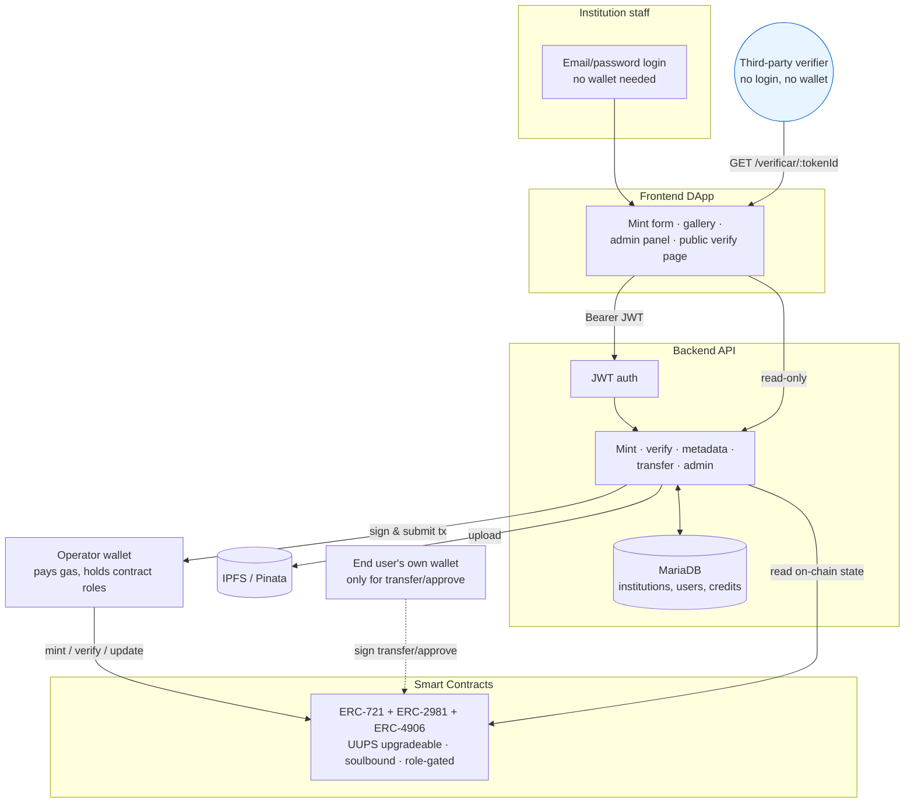

# Asset Tokenization Platform

> Blockchain infrastructure for tokenizing real-world assets — real estate, vehicles, certificates,
> official documents and intellectual property — with mutable metadata, on-chain verification,
> non-transferable records where required, and an onboarding experience that requires no crypto
> knowledge from institutions or end users.

This repo is documentation only. It's the map of a working, three-repo system — read it first, then
go read the code.

| | |
|---|---|
| ⚙️ [**Smart Contracts**](https://github.com/sergiom310/asset-tokenization-smart-contracts) | Solidity, OpenZeppelin, UUPS upgradeable, ERC-721/2981/4906 |
| 🔌 [**Backend API**](https://github.com/sergiom310/asset-tokenization-api) | Node.js, Express 5, multi-tenant institutions, ethers.js |
| 💻 [**Frontend DApp**](https://github.com/sergiom310/asset-tokenization-dapp) | React 19, Ethers.js v6, wallet + no-wallet UX |

---

## The problem

Institutions that issue or manage records of real-world assets — land registries, transport
secretariats, universities, notaries, IP offices, banks — depend on centralized databases and paper
trails that are slow to verify, easy to forge, and expensive to reconcile across parties. Blockchain
solves the trust problem, but only if the technology stays invisible to the people who actually have
to use it: an institution's back-office staff, and the third party checking a record months or years
later.

This platform is built around that constraint: **institutions operate through a normal web app with
email/password login, end users never need a wallet to receive a record, and anyone can verify one
from a public link with no account at all.**

## Use cases

| Asset type | Real-world example | Transferable? |
|---|---|---|
| Real estate | Property title / deed | Yes |
| Vehicle | Vehicle registration, technical inspection record | Yes |
| Certificate | Diploma, professional license, training credential | **No — soulbound** |
| Document | Government-issued ID document, official permit | **No — soulbound** |
| Intellectual property | Patent, trademark, copyright registration | **No — soulbound** |
| Artwork / Luxury item | Provenance and authenticity record | Yes |

---

## Architecture

**Why the contract is the least-trusted-required layer:** every mint, verification and soulbound
restriction that's already on-chain remains independently checkable against the contract itself, even
if the backend is redeployed, rewritten, or temporarily down. The backend and frontend exist to make
that trust *usable*, not to hold it themselves.

---

## Engineering approach: build, then audit yourself

Each repo's `SECURITY.md` documents its access control model — and, honestly, what was found wrong
during review and fixed, rather than only what looks good:

- **Smart contracts**: found and fixed a mint-time reentrancy issue where a malicious contract minted
  as the recipient of a soulbound token (a certificate, a legal document) could have transferred it
  away during the mint callback, before the soulbound flag took effect — a checks-effects-interactions
  violation. [Details →](https://github.com/sergiom310/asset-tokenization-smart-contracts/blob/main/SECURITY.md)
- **Backend API**: found and fixed a near-total authentication bypass — almost every endpoint that
  signs a transaction with the operator wallet (which holds every contract role) had no auth
  middleware, while CORS was open to any origin. Every affected route now requires the correct
  auth. [Details →](https://github.com/sergiom310/asset-tokenization-api/blob/main/SECURITY.md)
- **Frontend DApp**: reviewed directly — no XSS sinks, no hardcoded secrets — with the one real
  tradeoff (JWT in `localStorage`) explained rather than hidden. [Details →](https://github.com/sergiom310/asset-tokenization-dapp/blob/main/SECURITY.md)

None of this was live in production when found. The point isn't "everything is perfect" — none of
the three repos has an automated test suite yet, and that's stated plainly in each `TESTING.md`
rather than glossed over. The point is that the review process itself — reading the code adversarially,
not just functionally — is part of how this was built, and it's documented instead of hidden.

---

## Deployment model

The [backend](https://github.com/sergiom310/asset-tokenization-api)'s institution registration,
approval and credits model already supports two deployment shapes without any redesign:

- **Shared platform** — multiple institutions on one deployment, each isolated by account, as it
  runs today.
- **Dedicated / white-label instance** — the same codebase deployed for a single institution or
  government agency that wants its own instance rather than sharing infrastructure.

Data locality follows the same split either way: personal and institutional data lives only in the
database, never on-chain — see the backend's
[SECURITY.md](https://github.com/sergiom310/asset-tokenization-api/blob/main/SECURITY.md#data-locality--compliance-readiness)
for what that means for KYC/AML and data-protection requirements. This is architectural readiness,
not a compliance certification — no jurisdiction-specific legal review has been done.

---

## Repository breakdown

### [asset-tokenization-smart-contracts](https://github.com/sergiom310/asset-tokenization-smart-contracts)

A UUPS-upgradeable ERC-721 contract supporting 8 asset categories, per-token soulbound flags,
dynamic metadata for assets whose state changes over time, on-chain metadata history, ERC-2981
royalties, and role-based access control. Deployed and verified on Polygon Amoy and Base Sepolia
testnets.

### [asset-tokenization-api](https://github.com/sergiom310/asset-tokenization-api)

Express backend that lets institutions register, get approved, and mint on behalf of their end users
without those users ever holding a wallet — the backend's operator wallet pays gas and signs. Handles
IPFS uploads, credit-based multi-tenancy, and public no-login verification.

### [asset-tokenization-dapp](https://github.com/sergiom310/asset-tokenization-dapp)

React frontend covering the full lifecycle: minting form, personal gallery, transfer/approval flows
signed by the end user's own wallet, an admin panel for institution/role/royalty management, and the
public verification page third parties actually load.

---

## Tech stack

| Layer | Technology |
|---|---|
| Smart contracts | Solidity 0.8.28, OpenZeppelin 5.x, Hardhat, UUPS (EIP-1822) |
| Backend | Node.js 24, Express 5, ethers.js v6, MariaDB, JWT |
| Frontend | React 19, Vite 6, Ethers.js v6, React Router 7 |
| Storage | IPFS (Pinata) for static metadata; live API for dynamic metadata |
| Networks | Ethereum, Polygon, Base (testnet + mainnet) |
| Tooling | Bun, GitHub Actions (planned) |

---

## Roadmap

- Automated test suites across all three repos (each has its own `TESTING.md` with the concrete plan)
- CI pipelines (compile/lint/test on every push)
- Contract-factory pattern — one contract per institution instead of a shared one
- Per-token institution-ownership checks in the API
- Rate limiting and CSP hardening

---

## About

Built by **Sergio Melo** as a full-stack proof of capability for institutions, governments, and
enterprises exploring blockchain-based asset tokenization — a complete, working system across
contracts, backend and frontend, not an isolated demo.

- GitHub: [@sergiom310](https://github.com/sergiom310)
- LinkedIn: [linkedin.com/in/sergiom310](https://linkedin.com/in/sergiom310)

Open to discussing tokenization projects, technical roles, or consulting engagements in this space.
